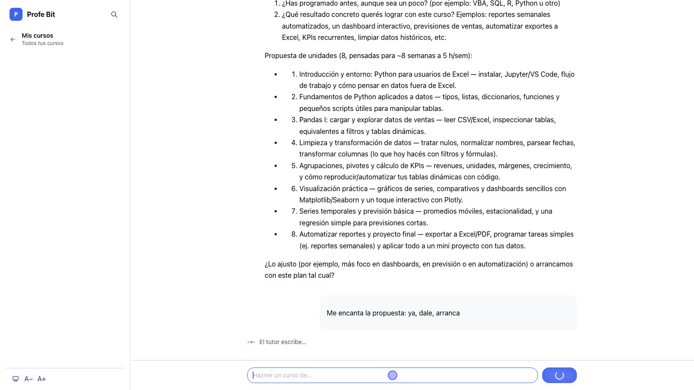

# Profe Bit — tutor de programación con LLMs

**Pides el curso conversando; cada clase es una conversación socrática con retos de código que corren en tu navegador.**

[](https://github.com/AndresGuido9820/trabajo2-agente-tutor/actions/workflows/ci.yml)
[](LICENSE)


[Página del proyecto](https://andresguido9820.github.io/trabajo2-agente-tutor/) ·
[Video de demostración](https://youtu.be/ENiJgR2DkmA) ·
[Reporte técnico](https://andresguido9820.github.io/trabajo2-agente-tutor/reporte.html)



Profe Bit enseña fundamentos de programación. El estudiante **pide su curso
conversando** ("hazme un curso de Python para analizar mis ventas; sé Excel"):
el asesor pregunta lo que falta, propone un temario y lo crea al confirmar.
Cada **clase es una conversación** con el tutor (método socrático), con
evaluación que desbloquea la siguiente, conversatorio de dudas al reprobar,
código ejecutable en el navegador (Pyodide), demos interactivas generadas por
el LLM y puntos/racha.

Es una aplicación local (FastAPI + React): la página del proyecto muestra el
recorrido y el video, pero para usar el tutor lo corres en tu máquina, con tu
API key de OpenAI o gratis con un modelo local.

Curso: *Normalización: aplicaciones de LLMs y Agentes para la enseñanza de
la programación básica* — Prof. Juan David Ospina Arango, Universidad
Nacional de Colombia.

## Cómo correrlo

Requisitos: Python ≥ 3.12 y [uv](https://docs.astral.sh/uv/). (No necesitas
Node: el frontend ya viene compilado.)

```bash
git clone https://github.com/AndresGuido9820/trabajo2-agente-tutor
cd trabajo2-agente-tutor
uv sync
cp .env.example .env
```

**Opción A: OpenAI** (la calidad con la que se diseñó; ~USD 0,18 por curso
con gpt-5-mini, ver el reporte). Pon tu `OPENAI_API_KEY=sk-...` en `.env` y:

```bash
uv run tutor-web              # abre http://127.0.0.1:8017 (UI web, React)
uv run tutor                  # alternativa: CLI en la terminal

# Opcional: turnos de chat más rápidos con un modelo liviano
TUTOR_MODEL_CHAT=gpt-5-nano uv run tutor-web
```

**Opción B: gratis, con un modelo local** vía cualquier servidor compatible
con la API de OpenAI, por ejemplo [Ollama](https://ollama.com). No hace falta
API key:

```bash
ollama pull gemma3:4b
TUTOR_BASE_URL=http://localhost:11434/v1 TUTOR_MODEL=gemma3:4b uv run tutor-web
```

Los modelos pequeños funcionan (el contrato JSON se verificó con
`gemma3:4b` usando `scripts/humo_llm.py`), pero los temarios, las preguntas y
las demos salen bastante más pobres y lentos que con gpt-5-mini, sobre todo
en CPU. Las ilustraciones (`TUTOR_IMAGENES=1`) solo existen con OpenAI.

## Qué hace (recorrido)

1. **Mis cursos**: menú con todos tus cursos y su progreso; "＋ Nuevo curso".
2. **Diseño conversacional + examen diagnóstico**: describes qué quieres
   aprender; el asesor resume, pregunta tu nivel/experiencia y objetivos,
   propone un temario y, al confirmar, te aplica un **examen diagnóstico**
   corto que mide tu conocimiento real — su resultado calibra el temario y
   todas las clases. El diseño queda **estructurado en la base de datos**
   (clase → título, objetivo, subtemas, prompt/guion) y como documento
   `curso.md` visible, descargable y **editable** (editor estructurado).
3. **Clases como conversaciones extensas**: cada clase se estructura en
   3-4 **objetivos de aprendizaje**, cada uno con su secuencia PRIMM
   (predices antes de que te explique) y un **mini-quiz de 2 preguntas**
   al cerrarlo (+5 puntos por acierto; si fallas ambas, el tutor repasa con
   otro ejemplo y reintentas). El tutor **escribe en vivo** (SSE) y decide
   con criterio si tu mensaje avanza el paso o es una duda. Un **panel
   lateral** muestra los objetivos marcándose en tiempo real. Los bloques
   de código traen **Pruébalo** (Python en tu navegador vía Pyodide) y
   al cerrar cada objetivo llega un **reto de código real** con tests
   automáticos estilo freeCodeCamp (+10 puntos, pista socrática si te trabas).
   El botón de **demo** genera una demo interactiva del objetivo (plantilla
   según el concepto, verificada antes de mostrarse, regenerable).
4. **Evaluación y progresión**: evaluación final de 6+ preguntas con
   **niveles Bloom** (recordar/comprender/aplicar) y **nota ponderada** —
   saber definiciones no basta si no aplicas. Las preguntas salen de un
   **banco por clase sin repetición entre intentos** y priorizan lo que
   fallaste en los mini-quices. Con 70+ apruebas (+30 puntos) y desbloqueas la
   siguiente clase; si no, **conversatorio socrático** y reintento con
   preguntas nuevas. Lo fallado entra al **Repaso del día** (repetición
   espaciada 1-3-7). Puntos, racha y estadísticas (Mi progreso)
   persistentes; buscador global (⌘K); exportar el curso a .zip.

## Arquitectura

La estructura del backend está organizada por área de dominio (los nombres de
las carpetas dicen qué hace el sistema, no qué framework usa):

```
frontend/  (React + Mantine, Vite)  →  build en src/tutor/static/dist
src/tutor/
  nucleo/          dominio puro
    models.py      dataclasses del dominio (Temario, Clase, Quiz, Perfil…)
    errores.py     jerarquía de excepciones (ErrorTutor y subtipos)
  ensenanza/       lógica pedagógica
    agente.py      orquestador: lecciones, quizzes, candados, chats, artefactos
    curso.py       temario/guiones/guías + persistencia del diseño
    evaluacion.py  quiz: generación LLM + calificación local determinista
    progreso.py    puntos, racha, candados, repaso espaciado 1-3-7
    perfil.py      perfil del estudiante (nivel, meta, experiencia)
    prompts.py     TODOS los prompts, versionados (PRIMM, misconceptions…)
  proveedor/       integración con el LLM
    llm.py         cliente OpenAI: reintentos con backoff, JSON validado
    imagenes.py    bonus: ilustración de clase con gpt-image-1
  persistencia/    almacenamiento
    db.py          SQLite por curso: curso, clases, perfil, progreso, chat
    exportar.py    exporta un curso a .zip de Markdown
  interfaces/      adaptadores de entrada
    web.py         API FastAPI (multi-curso; sirve el front)
    ui.py          CLI equivalente (misma lógica, sin navegador)
  config.py        configuración por entorno (.env)
  __main__.py      entry point de la CLI
```

- **Datos**: `data/cursos/<id>/tutor.db` (una BD por curso) + `curso.md`.
- **Seguridad**: la API key solo vive en `.env` (gitignoreado); las
  respuestas correctas de quizzes/checkpoints nunca viajan al navegador;
  las demos corren en `iframe sandbox` sin red. Excepción consciente: los
  tests de los retos de código sí viajan (se ejecutan en tu navegador con
  Pyodide); el objetivo es aprender, no vigilar.

## Desarrollo

```bash
uv run pytest              # 314 pruebas (LLM siempre con dobles)
uv run ruff format --check . && uv run ruff check .
uv run mypy src            # estricto

# Frontend (solo si vas a tocar la UI)
cd frontend && npm install && npm run dev    # proxy a :8017
npm run build                                 # regenera static/dist

# Manuales (cuestan tokens):
uv run python scripts/humo_llm.py             # humo del cliente LLM
uv run python scripts/exportar_curso.py datos-excel   # exporta un curso a Markdown
uv run python scripts/capturas_playwright.py  # capturas automatizadas de la app
uv run python scripts/e2e_reintento.py        # caída del server + reintento
uv run python scripts/a11y_playwright.py      # axe-core (no cuesta tokens)
```

CI en GitHub Actions: lint + tipos + pruebas + build del frontend en cada
push (`.github/workflows/ci.yml`).

### Accesibilidad

La app se opera completa con teclado (Tab/Enter/Espacio; `⌘K` abre el
buscador, `Esc` cierra modales). El chat es una región `aria-live` que
anuncia los mensajes del tutor; los botones-ícono llevan `aria-label`; los
temas claro y oscuro pasan contraste AA (los colores de la variante
"light" y el `dimmed` se ajustaron en `frontend/src/global.css`). La
auditoría automática con axe-core (`scripts/a11y_playwright.py`) corre
sobre Mis cursos, Clase y Mi progreso: 0 violaciones serias/críticas.

## Entregables del curso

- **Página del proyecto** (producto, arquitectura, prompts, ejecución):
  <https://andresguido9820.github.io/trabajo2-agente-tutor/>
- **Reporte técnico**:
  <https://andresguido9820.github.io/trabajo2-agente-tutor/reporte.html>
- **Video de demostración**: enlazado desde la página del proyecto.

## Contribuir

Issues y PRs son bienvenidos. Antes de abrir un PR corre lo mismo que corre
el CI: `uv run ruff format --check . && uv run ruff check . && uv run mypy src && uv run pytest`.
Las pruebas nunca llaman a la API real (el LLM siempre es un doble).

## Licencia

[MIT](LICENSE) © 2026 Andrés Felipe Guido Montoya.

